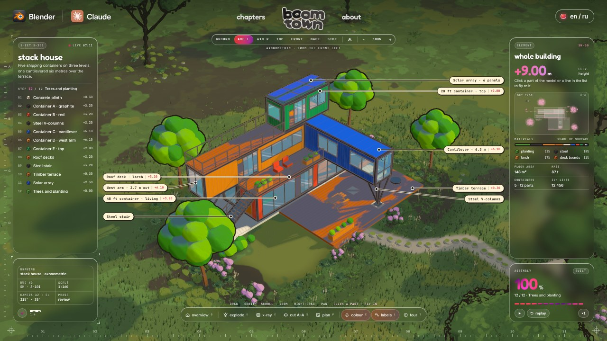
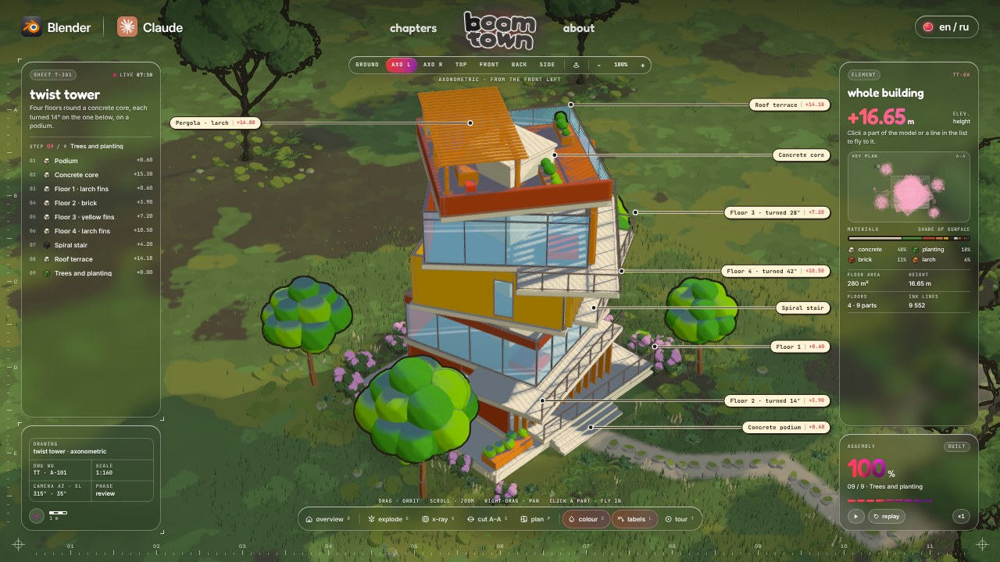
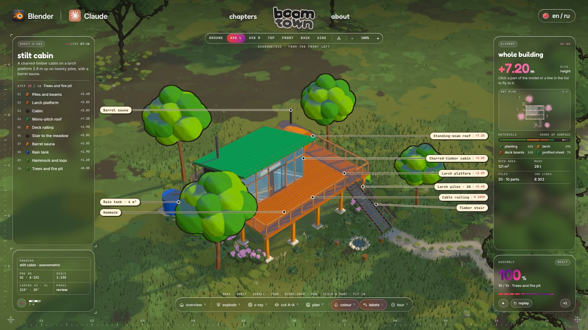

# boomtown

A Claude Code skill that builds any house in code and raises it part by part inside a 3D construction terminal.

Give Claude a photo, a sketch or a few lines about a house. It rebuilds it in three.js, every rib, pane, board and tree written as code, checks the build against the reference line by line, and stages it: the house draws itself on in ink, fills with colour, stands in a meadow, and one unbroken camera move flies through every frame and every part and back down to the grass.


| A-frame cabin | Glass barn |
|---|---|
|  |  |

| Container stack | Tower house | Stilt cabin |
|---|---|---|
|  |  |  |

## Install

```
npx skills add 0xwast3/boomtown -g -a claude-code
```

Then, once, in the installed folder:

```
npm install && npx playwright install chromium
```

You need Node.js 20 or newer. For the film you also need `ffmpeg`.

## Use

Give Claude Code a reference and ask in plain words:

> Here is a photo of a stone cottage with a slate roof. Build it in boomtown and stop at the stills so I can check them.

> Build a three-storey tower house: brick base, glass top, a spiral stair and a roof terrace. Then film the show.

> I approved the stills. Film it the way the a-frame example is filmed.

No picture yet? `docs/PROMPTS.md` has a prompt for one, or write the house as numbers.

Or open one of the 6 examples first:

```
node tools/build.mjs deck-house     # boomtown-out/deck-house.html
node tools/build.mjs a-frame
node tools/build.mjs glass-barn
node tools/build.mjs stack          # also tower, stilt
```

## How it works

1. **One reference** sets the building. Claude reads it and rebuilds it; it never imports it.
2. **Measured, not eyeballed**: footprint, eave, ridge, pitch and bays in metres, written down before any code.
3. **A checklist for that house**: 10 to 12 numbered lines Claude grades yes, partial or no every round.
4. **Parts a builder would name**: 8 to 13 of them in the order they go up, each with its own close-up, explode and labels.
5. **Stills first.** Claude stops after round 2 and waits for your yes. Nothing gets filmed before it.
6. **The show**: the house builds in 1 second, then one 24-second camera move through 12 views, rendered frame by frame to an mp4.

The whole method is in `docs/`, written so you can follow it with or without the code.

## What is inside

| | |
|---|---|
| `SKILL.md` | What Claude reads: the order of work, the rules that make it look right, the review loop. |
| `docs/JOB_DESCRIPTION.md` | The brief Claude reads before every house. Your corrections go into it. |
| `docs/CHECKLIST.md`, `docs/PROMPTS.md`, `docs/LESSONS.md` | The checklist format with a full example, every prompt, every mistake and the line it added. |
| `models/deck-house`, `a-frame`, `glass-barn`, `stack`, `tower`, `stilt` | 6 complete houses. One `model.js` each: the parts, the labels, the texts in English and Russian, the tour. |
| `terminal/` | The page around every house: header, frames, panels, dock, the ink and paint shaders, the meadow, the camera and the show. |
| `terminal/src/kit.js`, `terminal/src/shapes.js` | The building kit: boxes, members, glass, ink lines, walls on a footprint, glazing, railings, stairs, trees, cylinders, logs. |
| `tools/build.mjs` | Bundles a house into one offline HTML file, three.js and fonts inlined. |
| `tools/capture.mjs` | Renders stills, a 12-tile sheet of the show, or the film to mp4 or gif on a virtual clock. |

## Credits

Built with [three.js](https://threejs.org) (MIT). Fonts: Inter, Fredoka, Nunito and JetBrains Mono (SIL Open Font License).

MIT licence.
